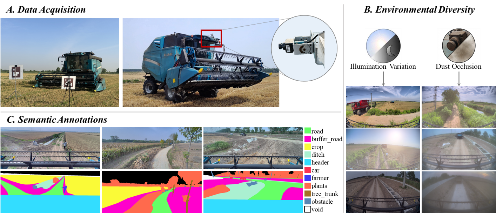

# Agricultural Off-Road Dataset

[](https://doi.org/10.1016/j.compag.2026.112474)
[](https://drive.google.com/file/d/1nGSZ4Fb6yTxZzr4ulcJVQU77QL3o-DIk/view?usp=sharing)

## Overview

The **Agricultural Off-Road Dataset** provides RGB images of unstructured agricultural field roads, collected from the forward-facing perspective of combine harvesters. It is intended to support research on semantic segmentation and visual perception for autonomous agricultural machinery, particularly under challenging illumination and dust conditions.

**This repository releases only a subset of the dataset described in our paper**, together with additional unlabeled frames immediately preceding and following selected annotated images. The public release does not contain the complete dataset used in the paper.

## Data Collection and Annotation

Images were collected during the 2025 summer and autumn harvest seasons in **Lianyungang (Jiangsu), Qingdao (Shandong), and Luoyang (Henan), China**. An RGB camera mounted on the roof of a combine harvester captured forward-facing field-road scenes. Following camera calibration, distortion correction, and cropping, images have a resolution of **1534 × 588 pixels**.

The scenes include unpaved and paved roads, field entrances and exits, varied lighting (normal, low, and strong illumination), and different degrees of dust contamination. The annotations cover the following semantic categories: **road, buffer road, crop area, ditch, harvester header, agricultural machinery vehicle, farmer, vegetation, tree trunk, other obstacles, and uncertain/unreachable area**. Annotations were prepared using CVAT.



*Fig. 1. Data collection and annotation (from the associated paper).*

## Released Data

The download includes a **partially released set of annotated images** and additional **unlabeled temporal neighboring frames**:

- **Annotated images:** selected RGB images with corresponding semantic annotations.
- **Unlabeled images:** the frames immediately before and after the corresponding annotated images. A filename beginning with `1_` indicates the **preceding frame**, while `2_` indicates the **following frame**.

For example, if `example.jpg` is an annotated key frame, `1_example.jpg` denotes its preceding frame and `2_example.jpg` its following frame (where these files are included). The adjacent frames are **not annotated**; do not interpret their filenames as segmentation class IDs.

**Note:** Adjacent frames may be highly similar. When developing train/validation/test splits, keep frames from the same recording sequence within the same split to avoid temporal data leakage.

## Download

The released dataset is available from **[Google Drive](https://drive.google.com/file/d/1nGSZ4Fb6yTxZzr4ulcJVQU77QL3o-DIk/view?usp=sharing)**.

## Citation

If you use this dataset in your research, **please cite both the associated paper and this GitHub repository**.

**Paper**

```bibtex
@article{zhang2026latent,
  title   = {Latent-space feature reconstruction-enhanced semantic segmentation for agricultural field roads under visual degradation},
  author  = {Zhang, Qi and Zhou, Jie and Chu, Yuxing and Wang, Chen and Fan, Rui and Zhang, Yawei and Tian, Wenbin and Chen, Du},
  journal = {Computers and Electronics in Agriculture},
  year    = {2026},
  pages   = {112474},
  doi     = {10.1016/j.compag.2026.112474},
  url     = {https://doi.org/10.1016/j.compag.2026.112474}
}
```

**Dataset repository**

```bibtex
@misc{cau457_agricultural_offroad_dataset,
  author       = {{CAU457}},
  title        = {Agricultural Off-Road Dataset},
  howpublished = {GitHub repository},
  url          = {https://github.com/CAU457/agriculture_offroad_dataset},
  note         = {Accessed: YYYY-MM-DD}
}
```

Repository: https://github.com/CAU457/agriculture_offroad_dataset

## Contact

For questions about the dataset, please open an [issue](https://github.com/CAU457/agriculture_offroad_dataset/issues) in this repository.
